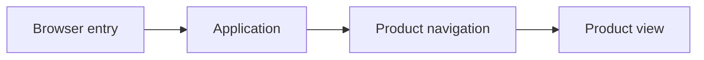

# Architecture Overview

GPT 3D Visualizer renders its application and navigation in the browser.

- Related implementation: [Navigation Design](../design/app/10-navigation.md).
- Code: client/src/App.tsx, client/src/components/navigation/FloatingNav.tsx, client/src/constants/animation.ts.

## Example
- Input: Open the application.
- Steps: Render the application and select a supported navigation item.
- Expected result: The corresponding product view opens.

