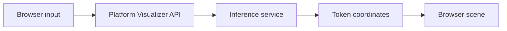

# Data Flow

The browser sends text through the platform Visualizer route. The platform forwards it to the inference service. The browser turns the resulting token coordinates into the visualization.

See [Architecture Overview](10-overview.md).
